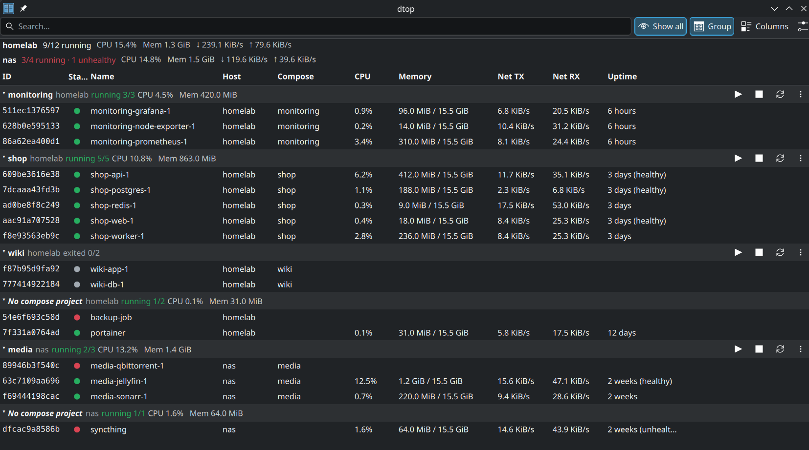
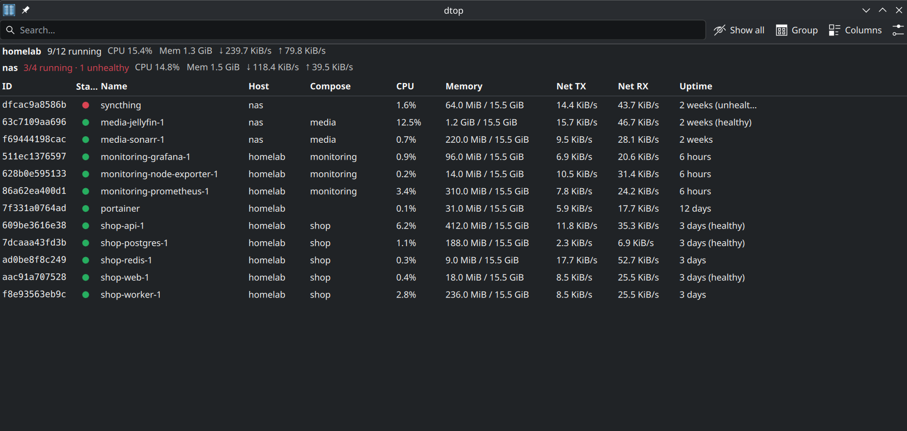
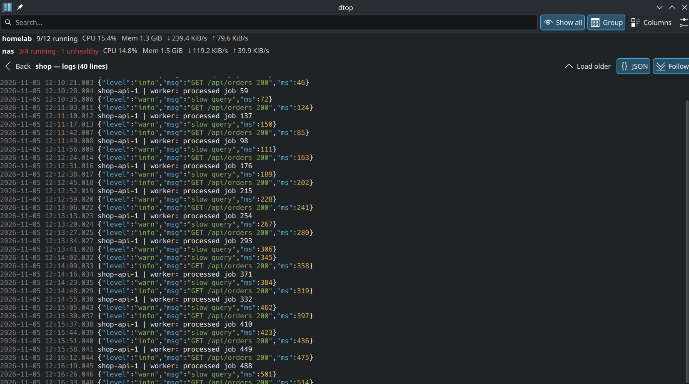

# dtop Plasma widget

A KDE Plasma 6 widget (`it.df.dtop`) that does what the [`dtop`](https://github.com/amir20/dtop) terminal app does: monitor Docker containers across hosts, sort and filter them, read logs, and start/stop/restart/remove them.

It drives the `docker` CLI, so anything `docker -H …` can reach works.



| Flat view | Project logs |
|---|---|
|  |  |

*Screenshots use demo data.*

> **Vibecoded.** This widget, its tests and this README were written almost entirely by an AI coding assistant (Claude Code), directed and reviewed by a human.
> It is tested on one machine only (see Requirements). Read the code before trusting it with production hosts; issues and fixes are welcome.

## Requirements

| Tool | Needed for | Tested with |
|---|---|---|
| KDE Plasma 6 (`plasmashell`, `kpackagetool6`) | running and installing the widget | Plasma 6.8.2, kpackagetool6 2.0 (KDE Neon) |
| Docker CLI (`docker`) | everything: the widget runs `docker ps`, `stats`, `logs`, … | Docker 29.9.3 |
| Permission to use Docker without `sudo` (user in the `docker` group, or rootless Docker) | local hosts; the widget cannot ask for a password | |
| Docker Compose v2 plugin (`docker compose`) | only the Group view's project actions and project logs | Compose v5.7.0 |
| `ssh` client with key-based login | only `ssh://` hosts | OpenSSH |
| A terminal, `konsole` by default | only "Open shell" (configurable in Settings) | |
| Node.js 24 | only running the tests | Node 24.17 |

The Docker daemon itself can be on another machine (`ssh://`, `tcp://`, `tls://` hosts); the CLI must be installed locally.

What happens when something is missing:

- **No `docker` on `PATH`:** each host shows "docker CLI not found: install Docker …" instead of containers.
  Install Docker from https://docs.docker.com/engine/install/, then restart Plasma (see below) so `plasmashell` picks up the new `PATH`.
- **No permission on the Docker socket:** the host shows Docker's own "permission denied … docker.sock" error.
  Add yourself to the group (`sudo usermod -aG docker $USER`), then log out and back in.
- **No Compose plugin:** the widget works; only Group-view project actions fail, with "Docker Compose plugin not found …".
  Install it from https://docs.docker.com/compose/install/linux/ (e.g. the `docker-compose-plugin` package).
- **No `ssh`:** `ssh://` hosts show the error and other hosts keep working.

Check your setup:

```bash
docker version            # client and server versions; fails if the daemon is unreachable
docker compose version    # only for the Group view's project actions
groups | grep -w docker   # local hosts without sudo
```

## Install

### From a release (recommended)

Download `it.df.dtop.plasmoid` from the [latest release](https://github.com/davidefabbri11/dtop-widget/releases/latest), or from the terminal:

```bash
cd ~/Downloads
curl -L -O https://github.com/davidefabbri11/dtop-widget/releases/latest/download/it.df.dtop.plasmoid
kpackagetool6 -t Plasma/Applet -i it.df.dtop.plasmoid
```

To upgrade, download the new file and run the same command with `-u` instead of `-i`, then restart Plasma (see Upgrade).

### From the source zip (no git needed)

```bash
cd ~/Downloads
curl -L -o dtop-widget.zip https://github.com/davidefabbri11/dtop-widget/archive/refs/heads/main.zip
unzip dtop-widget.zip
kpackagetool6 -t Plasma/Applet -i dtop-widget-main/it.df.dtop
```

### From a git clone

```bash
git clone https://github.com/davidefabbri11/dtop-widget.git
cd dtop-widget
kpackagetool6 -t Plasma/Applet -i it.df.dtop
```

The widget is installed in `~/.local/share/plasma/plasmoids/it.df.dtop/`; no root needed.

### Add it to Plasma

Right-click a panel or the desktop, choose **Add or Manage Widgets…**, search for **dtop**, and drag it onto the panel or the desktop.
To try it in a window first: `plasmawindowed it.df.dtop`.

### Upgrade

Download or `git pull` the new version, then:

```bash
kpackagetool6 -t Plasma/Applet -u it.df.dtop
systemctl --user restart plasma-plasmashell   # Plasma loads widget code only at startup
```

### Uninstall

Remove it from your panels, then run `kpackagetool6 -t Plasma/Applet -r it.df.dtop`.

## Tests

```bash
npm test
```

Pure logic lives in `it.df.dtop/contents/code/*.js` and is tested with `node --test`.
QML can be linted with `/usr/lib/qt6/bin/qmllint it.df.dtop/contents/ui/*.qml`.

## Hosts setting

One host per line:

```
<endpoint> [name=<label>] [dozzle=<url>] [certs=<dir>] [filter=<key=value>]...
```

- Endpoints: `local` (follows `DOCKER_HOST` / the active `docker context`), `unix://…`, `ssh://user@host[:port]`, `tcp://host:port`, `tls://host:port`.
- `certs=` is the directory holding `ca.pem`, `cert.pem`, `key.pem` for `tls://` (default `~/.docker`).
- `filter=` is passed to `docker ps --filter`; repeat it for several filters (same key = OR, different keys = AND).
- `#` starts a comment.

SSH hosts must work non-interactively (key auth / agent); a host that hangs times out after 5 × the refresh interval and shows its error.

## Mapping from `~/.config/dtop/config.yaml`

| dtop | widget |
|---|---|
| `hosts[].host` / `name` / `dozzle` / `filter` | Hosts setting line: `<host> name=… dozzle=… filter=…` |
| `all` | "Show all" toolbar toggle |
| `sort`, `sort_direction` | Click a column header (again to reverse) |
| `columns` | "Columns" toolbar menu |
| `stats_header` | Settings → Host stats header |
| `icons`, `hyperlinks` | Not applicable |

## Using it

- Panel: icon + `running/total`; a red dot means an unreachable host or an unhealthy container.
- Popup: search field, per-host summary, sortable table.
- Mouse: click, Ctrl-click, Shift-click to select; right-click for the action menu; double-click for logs.
- Keyboard: Up/Down or j/k, PageUp/PageDown, Home/End; Enter opens the action menu; Right arrow opens logs; Esc/Left goes back.
- Action menu: Logs, Details (`docker inspect`), Start, Stop, Restart, Remove (with confirmation), Open shell (in the configured terminal), Open in Dozzle, Select compose project.
  Actions apply to the whole selection when the clicked row is part of it.
- Logs: last N lines (Settings → Log lines per page), "Load older" pages backwards, Follow appends new lines, JSON toggle colourises JSON log lines.
- Group (toolbar): groups the table by Compose project (`com.docker.compose.project`), one collapsible header per host and project; containers without a project go under "No compose project".
  Header: status (`running N/M` counts all of the project's containers), CPU/memory, and ▶ Start, ■ Stop, ⟳ Restart, ⋯ (or right-click) for the project menu: Start, Up (apply changes), Stop, Restart, Pause, Unpause, Pull images, Build, Recreate, Project logs, Select all containers, Down… (confirmation, optional `-v`).
  Up, Pull, Build and Recreate need the compose files: they use the file set (`working_dir` + `config_files` labels) shared by most of the project's containers, run over `ssh` on `ssh://` hosts, and are disabled on `tcp://`/`tls://` hosts.
  Containers in a collapsed group are never targeted by container actions.

## Known limitations

- `docker stats` rounds network/disk counters to 3 significant figures (`35MB`), so low rates jump between 0 and bursts.
- Stats (CPU, memory, I/O) are only collected while the popup is open; the panel only needs container counts.
- The Dozzle link format is `<dozzle>/container/<short id>`; it was not verified against a live Dozzle.
- A project disappears from the grouped view after Down: the list comes from existing containers (same as `docker compose ls`).
- Project actions act on every container of the project, including ones hidden by the host's `filter=` options.
- No live output for Pull/Build/Up: the result (or error) shows when the command exits.

## Release

```bash
npm test
npm run package   # builds it.df.dtop.plasmoid (metadata.json at the archive root)
```

Bump `KPlugin.Version` in `it.df.dtop/metadata.json` (and `version` in `package.json`) before building.
Install the file locally with `kpackagetool6 -t Plasma/Applet -i it.df.dtop.plasmoid`, or upload it to the KDE Store under **Plasma 6 Applets**, tagged `ai-generated`.

## License

GPL-2.0-or-later. See [LICENSE](LICENSE).
